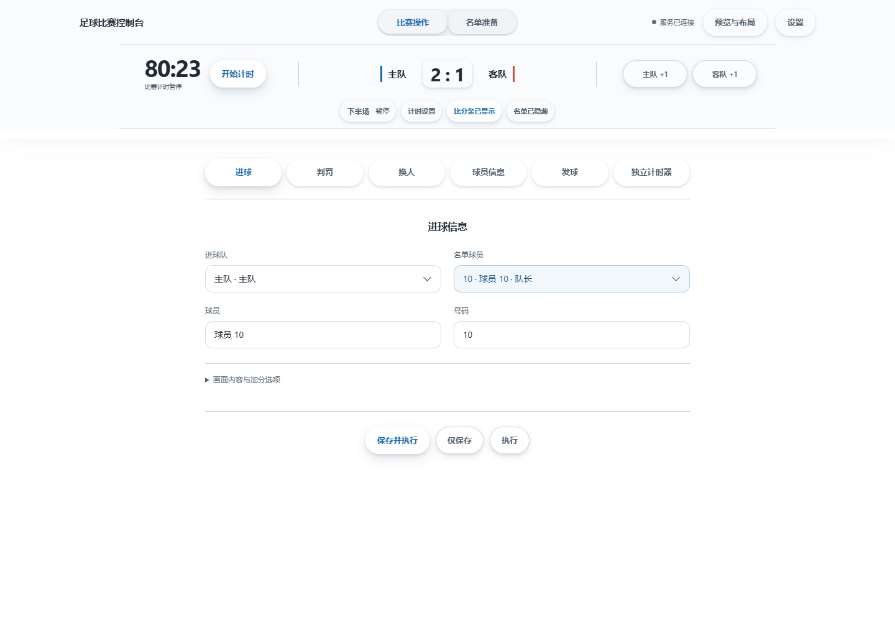

# 足球转播控制台

用于 vMix 的足球比赛图形包装。可以在控台操作比分、计时、进球、判罚、换人和名单，再通过一个网页输入叠加到直播画面。

[下载](https://gitee.com/alanhe0728/vibe-vmix/releases/tag/v1.1.0) | [使用说明](docs/USAGE.md) | [更新记录](docs/CHANGELOG.md) | [问题反馈](https://github.com/AlanHe0728/vibe-vmix/issues)



## 功能

- 比分和比赛时钟，支持正计时、倒计时和自动切换半场。
- 进球、红黄牌、换人、发球和球员信息条。
- 首发与替补名单，支持粘贴、TXT、CSV、TSV 和 Excel 导入。
- 通过名单选择球员，换人后更新场内名单，保留 GK 和队长标记。
- 保存双方球队、队徽和名单，下一场比赛可以直接读取。
- 自定义队徽、字体、颜色和布局，在预览中拖动、缩放图形。
- 使用 Ulanzi D200 按键操作常用功能。

## 下载和使用

[下载 Windows 便携版 1.1.0](https://gitee.com/alanhe0728/vibe-vmix/releases/tag/v1.1.0)

支持 Windows 10/11 64 位，无需另装 Node.js 或浏览器。vMix 需要自行安装；使用 D200 时还需要 Ulanzi Studio。

1. 下载并解压完整的便携包，双击 `足球转播控制台.exe`。
2. 在名单准备中填写球队资料，导入名单并保存首发。
3. 打开设置中的设备连接，复制联合上屏地址，在 vMix 添加网页浏览器输入。画布设为 1920×1080。
4. 回到比赛操作，使用顶部按钮控制比分和计时，在下方操作进球、判罚等事件。

如果下载的是 `.001`、`.002` 分卷，把所有分卷和发布页提供的合并脚本放在同一文件夹，合并后再解压。便携包目前在 Gitee 发布，GitHub 同步源码和版本标签。

比赛期间请保持程序运行，关闭主窗口会停止服务。顶部加分按钮只修改比分，不播放进球动画。其他操作见[使用说明](docs/USAGE.md)。

## 数据备份

比赛信息保存在程序目录的 `data/state.json`，界面偏好保存在 `data/browser`，不会自动上传。

备份或升级前先退出程序，再复制整个 `data` 文件夹。升级时将旧版的 `data` 放入新版目录，不要用新包里的空白数据覆盖旧数据。

## 文档

- [使用说明](docs/USAGE.md)
- [比赛配置文件格式](docs/MATCH_CONFIG.md)
- [D200 按键设置](docs/D200_SETUP.md)
- [更新记录](docs/CHANGELOG.md)

## 开发

安装 Node.js 22 或以上版本，然后运行：

```sh
git clone https://github.com/AlanHe0728/vibe-vmix.git
cd vibe-vmix
npm start
```

打开终端显示的地址即可使用。Windows 也可以双击 `control/启动控制面板.bat`。

公共代码在 `core/`、`modules/` 和 `ui/`。新增赛事或舞台节目可以复用现有服务，接入方式见[架构说明](docs/ARCHITECTURE.md)和 [API 文档](docs/API.md)。构建便携程序见[构建说明](docs/PORTABLE_APP.md)。

第二版包装仍在开发，不包含在 1.1.0 便携包中。需要试用时请阅读[第二版说明](v2/README.md)。

## 反馈

源码：[GitHub](https://github.com/AlanHe0728/vibe-vmix) 和 [Gitee](https://gitee.com/alanhe0728/vibe-vmix)。

问题可以提交到 [GitHub Issues](https://github.com/AlanHe0728/vibe-vmix/issues) 或 [Gitee Issues](https://gitee.com/alanhe0728/vibe-vmix/issues)。请说明版本、操作步骤和出现的问题；启动失败时可以附上 `data/desktop-error.log`。

## 许可证

项目许可证见 [LICENSE](LICENSE)。Motion、SheetJS 和 MicroKit 的许可随源码提供。
