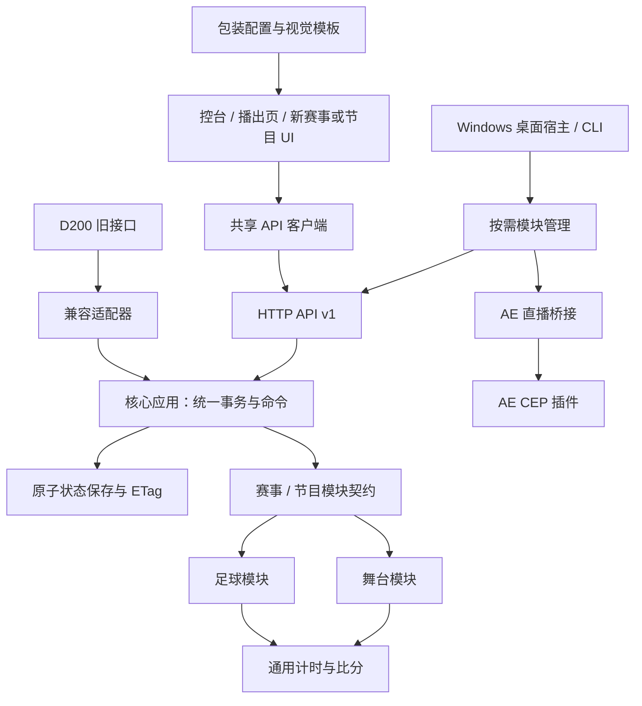

# 架构与扩展约定

本项目采用「共享核心 + 赛事/节目模块 + 视觉包装 + 运行适配器」。新增赛事写规则与所需界面，新增皮肤写包装差异；二者都复用状态保存、命令执行、API、计时、比分基础能力和浏览器传输。

2.0 增加 `server/workspace-server.js` 的按需宿主。轻量目录不引用模块实现，启用后才导入 football / stage / ae-live 组装入口，各自使用独立回环端口和数据文件。关闭和卸载负责暂停计时、停止渲染、关闭连接及释放模块缓存。舞台模块在 `modules/stage`，AE 命令校验在 `modules/ae-live`；AE 的桥接会话与二进制画面由专用 HTTP 适配器处理，不进入通用状态 JSON。`desktop/native/Program.cs` 为新 WinForms/WebView2 宿主，`ae-plugin` 为 CEP 插件；原 Electron 入口只保留历史兼容。完整说明见 [WORKSPACE_2.md](WORKSPACE_2.md)。

## 检查结论与本次改造

原版与 `v2/` 曾分别维护完整服务、计时、名单、硬件动作和大量相同的前端文件。`serve.js` 同时负责业务、文件保存、HTTP 与静态资源，`panel.html` 和 `graphics.html` 内嵌整段业务脚本。修改一个公共行为需要在两处同步，其他赛事也容易从复制足球目录开始。

现在两版共用核心与足球模块。包装差异集中在 `packages/*.json`、两版的 HTML 模板和第二版独有动画中；公共前端文件只保留一份。HTML 中的控制和渲染脚本按职责拆开，旧导入路径仅保留很薄的兼容入口。

## 目录职责

```text
football-broadcast-pack/
├─ core/                    状态事务、原子保存、模块契约、通用 clock/score
├─ server/                  HTTP、v1 API、旧接口适配、静态资源、启动逻辑
│  └─ powershell/           无 Node 环境的旧足球接口兼容后备实现
├─ modules/
│  ├─ football/             足球规则、名单、换人、动作目录、配置格式
│  ├─ stage/                节目单、图层、模板与播出状态
│  └─ ae-live/              AE 直播命令校验
├─ packages/                经典/第二版的布局、主题、功能配置
├─ ui/
│  ├─ shared/               通用 API 客户端，可供其他赛事/节目直接使用
│  ├─ workspace/            按需模块选择和桌面工作区
│  ├─ stage/、ae-live/      舞台和 AE 控制页面及播出画面
│  ├─ control/              两版公共控台、预览脚本、样式与 vendor
│  └─ titles/               公共渲染、编辑器、动效、图标与独立模板入口
├─ control/                 原版模板、旧导入/启动适配、本地 state.json
├─ titles/                  原版联合上屏 HTML
├─ v2/                      第二版模板、独有动画与独立本地数据
├─ desktop/native/          Windows WebView2 桌面宿主
├─ desktop/                 历史 Electron 入口和便携数据适配
├─ ae-plugin/               After Effects CEP 面板与宿主脚本
├─ packaging/               构建、运行文件清单、发行数据清理
├─ examples/stage/          可运行的舞台 API 扩展示例
├─ scripts/                 语法、依赖方向、测试入口
└─ tests/                   核心/API、现有业务与真实浏览器回归
```

工作区中的 `microkit-ui/` 是独立的 UI 参考项目，`bitv-liquid-glass/` 是美术素材项目，`.publish/`、`dist/` 是既有发布相关目录，均不属于软件核心。本次不改造第三方参考项目，也不覆盖已有发行版。



## 依赖方向

- `core/` 不引用 `modules/`、`server/`、UI 或 Electron。
- 业务模块只引用自身与 `core/`；不读取文件、不调用 HTTP、不操作 DOM。
- `server/football-server.js` 是组装入口：选择足球模块、包装配置和公共资源挂载。通用 HTTP 服务不认识足球字段。
- `desktop/` 管窗口与进程，业务仍交给同一个服务；退出时调用 `server.pauseClocks()`。
- `ui/shared/api-client.js` 负责传输与错误，具体模块 UI 负责表单和渲染。
- `npm run check` 检查业务模块与核心的依赖方向，防止后续重新交叉耦合。

## 模块契约

准确类型见 `core/module-contract.js`。每个模块实现 `id`、`name`、`migrate`、`reduce`、`status`，按需提供 `commands`、`advance`、`pause` 和 `capabilities`。

```js
{
  id: 'my-event',
  name: '赛事名称',
  capabilities: ['score', 'timer'],
  migrate(saved, now) { /* 读取旧数据，返回状态；不重播事件 */ },
  reduce(current, patch, now) { /* 校验后返回新状态 */ },
  status(current, now) { /* 返回轻量状态 */ },
  commands: [{
    id: 'score.add', label: '加分',
    execute(current, payload, now) { /* 返回 patch，统一交给 reduce */ },
  }],
  advance(current, now) { /* 没有自动变化时返回 null */ },
  pause(current, now) { /* 没有需要暂停的任务时返回 null */ },
}
```

所有钩子同步执行；输入状态深度冻结，必须返回新的普通 JSON 对象。命令先根据**最新已提交状态**生成 patch，再经同一条 `reduce → 保存 → 发布` 路径执行。`execute` 不自行保存数据。

校验失败不写文件。保存前准备好新状态及缓存，临时文件原子替换成功后才更新内存与 ETag。失败时比分、换人、事件序号和客户端看到的状态都保留原值。自动推进每 200ms 检查一次，无变化返回 `null`，避免持续保存或复制内嵌图片。304 轮询不复制状态正文。

一个服务实例使用一个模块、一个状态文件。不同比赛、舞台或包装可以启动独立实例与端口，隔离数据；核心不提供播出中跨模块热切换。多个进程不要同时写同一个状态文件。

## 新增赛事或舞台节目

1. 在 `modules/<id>/` 实现契约；直接使用 `core/clock.js` 和 `core/score.js`，只写该赛事独有的节次、计分规则、名单限制等。
2. 用 `server/create-server.js` 注入模块与独立状态文件。HTTP 路由、事务、文件保存与定时调度直接复用。
3. 新客户端通过 `/api/v1/module`、`/api/v1/commands` 发现能力，使用共享 API 客户端。只制作需要的控台与播出模板。
4. 相同赛事的不同视觉风格仅新增包装配置与视觉资源，不复制赛事模块。足球的两种包装是现成例子。
5. 为新增规则补充测试；使用临时状态文件，不拿真实比赛做测试。

舞台示例已完整实现节目条显示/隐藏、独立事件序号、倒计时和退出暂停，可用 `npm run example:stage` 在 8125 端口启动。它复用同一核心、HTTP 服务与计时器，不包含足球比分、半场或名单字段。该示例交付的是 API 接入参考，未制作舞台控台和播出美术模板。

## 兼容与边界

原版 8123、第二版 8124、原有 HTML URL、`/state.json`、`/api/d200/*` 和 CommonJS 导入路径保留。原版与第二版状态文件继续位于各自 `control/state.json`，本次没有迁移或覆盖真实比赛数据。第二版首次初始化与便携版的数据清理规则保留。

旧控台为兼容已有 HTML 事件绑定，仍有页面级全局函数；它们已按职责拆分到共享 UI 文件中，属于旧页面适配边界。新模块应通过 API 与自己的视图对接，不依赖这些足球页面全局变量。本次没有把所有 HTML、CSS 重写成新前端框架。

PowerShell 后备服务合并为一份，只维护既有足球接口；新的版本化 API 和扩展模块使用 Node 服务，便携软件自带该运行环境。新增赛事不需要再写一遍 PowerShell 业务逻辑。

静态资源采用明确挂载，比赛状态、核心源码、桌面源码和目录外文件不能由静态 URL 读取。`/state.json` 仍是本机控制服务的公开状态接口。该软件按本机使用设计，本次不引入远程登录、多用户权限或跨进程数据库。

## 开发与验证

源码运行推荐 Node.js 22 及以上；正式便携程序继续自带运行环境。`npm ci` 只安装开发格式化工具，运行服务无需 npm 依赖。

```text
npm start                 原版
npm run start:v2          第二版（首次初始化仍可用原来的 BAT）
npm run example:stage     舞台 API 扩展示例
npm run check             语法与依赖方向检查
npm run format:check      公共代码格式检查
npm test                  核心/API、HTTP、D200 回归
npm run test:ui           Edge 控台、播出和双后端完整业务回归
```

Windows 浏览器测试默认使用本机 Edge。测试状态及浏览器配置使用临时目录；部分视觉测试会更新原有截图输出目录。

打包通过 `packaging/app-files.js` 明确收集 `core/server/modules/packages/ui` 及旧入口，不打入本地比赛 JSON。`tests/core.test.js` 验证复制后的运行目录可脱离源码启动；`tests/portable.js <便携目录>` 验证实际 EXE。

API 路由、返回格式与调用示例见 [API.md](API.md)。
